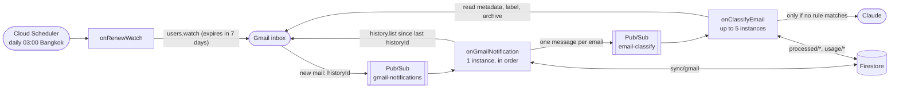
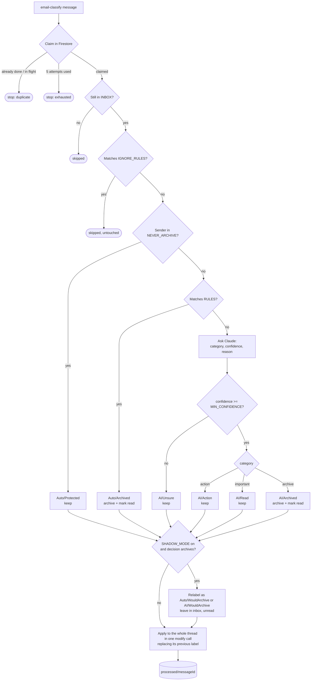

# email-classifier

Triages a personal Gmail inbox automatically. Every new inbox email gets a label, and anything unimportant is archived and marked read. Cheap deterministic rules run first; Claude is only called for mail the rules do not cover.

Runs as four Firebase Cloud Functions (2nd gen, `asia-southeast1`) on top of Gmail push notifications, Pub/Sub and Firestore.

## How it works

### The pipeline



1. **Watch** - `onRenewWatch` asks Gmail to publish inbox changes to the `gmail-notifications` topic. A watch expires after 7 days, so it is renewed daily.
2. **Sync** - Gmail's notification only carries a `historyId`, not the email. `onGmailNotification` asks Gmail for every message added to the inbox since the last saved `historyId`, publishes one `email-classify` message per email, then saves the new `historyId`. It runs as a single instance so the cursor advances in order.
3. **Classify** - `onClassifyEmail` handles one email per invocation: decide, apply the label, write the result to Firestore.
4. **Weekly summary** - every Sunday at 18:00 Bangkok time, `onWeeklySummary` reads the last 7 days of `processed/*` and puts a summary email in the inbox: what was archived (with the reason and a link to find it), what was kept and why, what an ignore rule left untouched, and what failed. It is inserted straight into the inbox from the mailbox to itself, and the classifier skips it.

### The classifier

Each email goes through the checks below in order. The first one that matches wins.



**Threads.** Gmail shows a thread with the labels of all its messages, so the decision is applied to the whole thread. Each new message in the thread is classified again, and its label replaces the one the thread had before. A reply that turns a notification thread into something you need to act on moves it from `AI/Archived` to `AI/Action`, and the other way round.

Labels tell you who decided: `Auto/*` means no LLM was involved (a rule or a protected sender), `AI/*` means Claude decided.

| Label                                  | Meaning                                        | Archived |
| -------------------------------------- | ---------------------------------------------- | -------- |
| `Auto/Protected`                       | Sender is in `NEVER_ARCHIVE`                   | no       |
| `Auto/Archived`                        | Matched a rule in `RULES`                      | yes      |
| `AI/Action`                            | You need to do something                       | no       |
| `AI/Read`                              | Worth reading, no action needed                | no       |
| `AI/Archived`                          | Nothing important                              | yes      |
| `AI/Unsure`                            | Claude's confidence was below `MIN_CONFIDENCE` | no       |
| `Auto/WouldArchive`, `AI/WouldArchive` | Shadow mode: would have been archived          | no       |

**What Claude sees.** Only metadata: sender address, subject (300 chars), Gmail's snippet (500 chars), Gmail category labels, and whether a `List-Unsubscribe` header exists. The full body is never fetched. The model is forced to answer through a `classify_email` tool call, and the prompt treats email content as untrusted data.

**Shadow mode.** With `SHADOW_MODE=true` nothing is ever archived or marked read. Emails only receive a `*/WouldArchive` label, so you can review the decisions in Gmail before trusting it.

### Reliability

- **No lost emails.** Classify requests are published before the `historyId` is saved. A crash in between causes duplicates, never gaps.
- **Duplicates are harmless.** Each email is claimed in a Firestore transaction (`processed/{messageId}`). A finished or in-flight claim makes the second delivery a no-op. A claim older than 5 minutes is treated as a dead instance and can be retaken.
- **Retries are capped.** Pub/Sub retries forever, so attempts are counted per email and it gives up after 5. Gmail notifications older than 1 hour are dropped, since any newer notification re-syncs from the saved cursor.
- **Expired cursor.** If the saved `historyId` is too old for Gmail to replay, the sync restarts from the current notification.

### Firestore data

| Document                | Purpose                                                                                                    |
| ----------------------- | ---------------------------------------------------------------------------------------------------------- |
| `sync/gmail`            | The `historyId` cursor of the last sync                                                                    |
| `processed/{messageId}` | Claim state, attempt count, and the decision log (sender, subject, label, reason, confidence, token usage) |
| `usage/{YYYY-MM-DD}`    | Daily LLM totals in UTC: calls, tokens, estimated cost, split by model                                     |

`costUsd` is an estimate from the price table in `functions/src/services/anthropic-pricing.ts`. Calls to a model missing from that table are counted in `unpricedCalls` instead of being treated as free.

## Project layout

```text
functions/src/
├── index.ts          # exports the four functions
├── config.ts         # region, topic names, params and secrets
├── handlers/         # Firebase triggers: validate the event, call a use case
├── usecases/         # the logic: process-mailbox-change, classify-email, renew-watch, weekly-summary
│   └── rules.ts      # RULES and IGNORE_RULES - edit this to add your own
├── services/         # Gmail, Anthropic and Pub/Sub clients, pricing table
└── db/               # Firestore reads and writes
```

## Development

### Prerequisites

- Node 24 (`nvm use` reads `.nvmrc`)
- pnpm 12 (`corepack enable`)
- Access to the Firebase project in `.firebaserc`, then `pnpm exec firebase login`

### Commands

```bash
pnpm install        # also installs the git hooks

pnpm test           # run unit tests (vitest)
pnpm dev            # build and start the Functions emulator
pnpm lint           # oxlint
pnpm format         # oxfmt
pnpm knip           # find unused code and dependencies
pnpm deploy         # deploy the functions
```

Inside `functions/`: `pnpm test:watch`, `pnpm build:watch`, `pnpm shell` (interactive functions shell) and `pnpm logs`.

The use cases in `functions/src/usecases/` are covered by unit tests, so most changes can be developed with `pnpm test` alone.

Commits must follow [Conventional Commits](https://www.conventionalcommits.org/) (`feat:`, `fix:`, ...). The pre-commit hook lints and formats staged files.

### Configuration

Parameters live in `functions/.env.<project-id>`:

| Parameter         | Default            | Purpose                                                              |
| ----------------- | ------------------ | -------------------------------------------------------------------- |
| `GMAIL_ADDRESS`   | required           | The mailbox to triage. Notifications for other addresses are ignored |
| `GMAIL_CLIENT_ID` | required           | OAuth client ID                                                      |
| `ANTHROPIC_MODEL` | `claude-haiku-5-5` | Model used for classification                                        |
| `SHADOW_MODE`     | `true`             | Label only, never archive                                            |
| `MIN_CONFIDENCE`  | `0.8`              | Below this, the email is labelled `AI/Unsure` and kept               |
| `NEVER_ARCHIVE`   | empty              | Protected senders: `someone@x.com` or a whole domain `@x.com`        |

Secrets live in Secret Manager:

```bash
pnpm exec firebase functions:secrets:set ANTHROPIC_API_KEY
pnpm exec firebase functions:secrets:set GMAIL_CLIENT_SECRET
pnpm exec firebase functions:secrets:set GMAIL_REFRESH_TOKEN
```

The refresh token must belong to `GMAIL_ADDRESS` and carry the `gmail.modify` scope.

### First-time setup of a new project

1. Enable the Gmail API, Firestore and Cloud Scheduler in the Google Cloud project.
2. Set the parameters and secrets above.
3. `pnpm deploy`. This creates the `gmail-notifications` and `email-classify` topics.
4. Grant `gmail-api-push@system.gserviceaccount.com` the **Pub/Sub Publisher** role on the `gmail-notifications` topic, so Gmail is allowed to publish to it.
5. In Cloud Scheduler, **Force run** the `onRenewWatch` job once to start the watch. After that it renews itself daily.
6. Keep `SHADOW_MODE=true`, review the `*/WouldArchive` labels in Gmail for a while, then set it to `false` and redeploy.

### Adding a rule

Edit `functions/src/usecases/rules.ts`. A rule matches on `from`, `subject`, or both (all given fields must match):

```ts
export const RULES: Rule[] = [
  {
    name: 'kbank-slip',
    from: /@kasikornbank\.com$/,
    subject: /Result of Bill Payment \(Success\)/i,
  },
];
```

- `RULES` - archive and mark read without calling the LLM.
- `IGNORE_RULES` - leave the email exactly as it arrived: no label, no LLM call.
